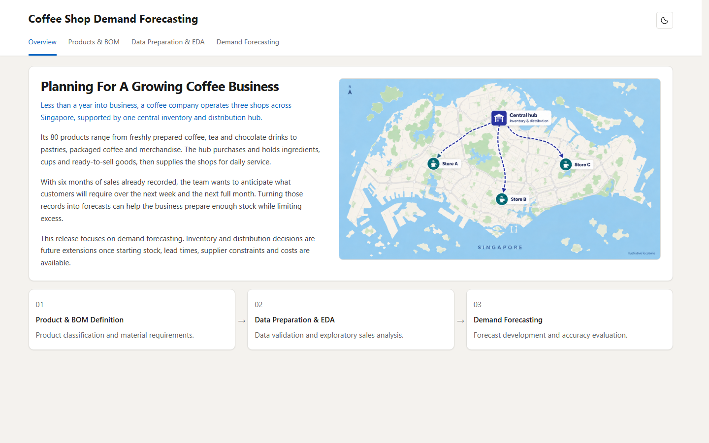
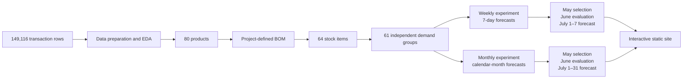
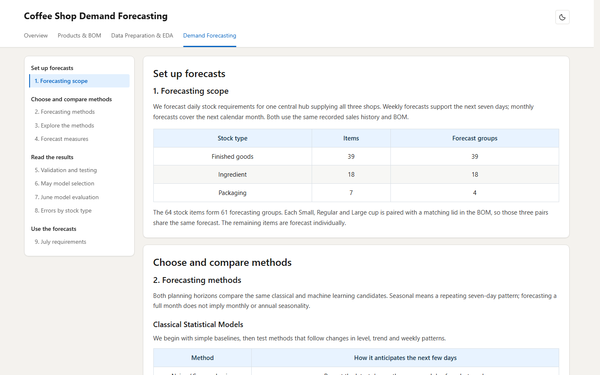

# Coffee Shop Demand Forecasting

This project converts six months of public coffee-shop transactions into weekly and monthly stock-item demand forecasts for a hypothetical three-outlet business in Singapore. A project-defined bill of materials (BOM) translates the recorded product sales into daily requirements for ingredients, packaging, and ready-to-sell goods.

Sixteen classical statistical and machine-learning candidates compete separately for each demand group. May data select the method with the lowest mean squared error, June evaluates the frozen choices against a seven-day seasonal-naive baseline, and the selected methods are refitted through 30 June to forecast July requirements.

[View the interactive analysis](https://alexwang-01.github.io/coffee-shop-demand-forecasting/) · [Forecasting methodology](docs/methodology.md) · [Validation and limitations](docs/validation.md)



## Architecture



Three cup-and-lid pairs have exactly proportional demand under the BOM. The workflow models each shared signal once, then restores each stock item's quantity with its verified ratio. This retains all 64 item-level outputs while avoiding duplicate forecasting problems.

## Key Capabilities

- Source-hash verification and explicit separation of observed data from project assumptions
- Product-to-stock conversion through a documented, project-defined BOM
- Daily hub requirements pooled across three relabelled stores
- Weekly rolling-origin validation and full-calendar-month validation
- Per-group comparison of 16 classical and machine-learning candidates
- Exact lowest-May-MSE selection with no subjective simplicity rule
- Frozen model choices evaluated retrospectively on later June dates
- Seasonal-naive benchmark, interpretable error measures, and category-level comparisons
- Reconciled July forecasts for all 64 stock items over 7-day and 31-day horizons
- A responsive GitHub Pages interface with light and dark modes

## Forecasting Design

### Experiment Timeline

| Experiment | May model selection | June evaluation | Forward output |
| --- | --- | --- | --- |
| Weekly | Four rolling 7-day windows; 28 scored dates | Four rolling 7-day windows; 28 scored dates | 1–7 July |
| Monthly | One 31-day calendar forecast | One 30-day calendar forecast | 1–31 July |

Every candidate must cover all May dates for the relevant experiment. The candidate with the lowest May MSE is selected for that group; alphabetical order resolves exact numeric ties only. June measures how those choices perform on later dates and never changes the selected model.

### Candidate Methods

| Family | Methods |
| --- | --- |
| Classical statistical | Naive, seasonal naive, MA(7), MA(14), SES, Holt, additive Holt-Winters, multiplicative Holt-Winters, ARIMA, SARIMA |
| Machine learning | Linear regression, Ridge(1), Ridge(10), random forest, Boosting(1), Boosting(10) |

The machine-learning models use demand lags, trailing means and variation, a time index, and weekday sine/cosine features. Multi-step predictions are recursive. ARIMA and SARIMA orders are identified with a bounded AIC search using January–April history and are then frozen. The interactive teaching explorer shows how the methods respond to steady, growing, and weekly demand patterns.

### Measures and Baseline

MSE selects a model within each group. MAE and RMSE express error in the stock item's native unit, Bias indicates systematic under- or overforecasting, and MASE scales error by the group's historical seven-day variation so litres, kilograms, and individual units can be compared.

The common baseline is **seasonal naive**: repeat the demand observed seven days earlier. It is included in the candidate pool and is also the fixed June comparator. MASE values are error scores rather than percentages of demand; lower is better.

## Interactive Analysis

The static site presents the project as four connected sections without exposing notebook code in the reader interface.

| Page | Focus |
| --- | --- |
| Overview | Business scenario, project boundary, and analysis roadmap |
| Products & BOM | Product classification and the stock required for each sale |
| Data Preparation & EDA | Data-quality checks, business patterns, and conversion to hub requirements |
| Demand Forecasting | Method explorer, validation design, model choices, June evaluation, and July forecasts |



The Demand Forecasting page keeps the common methodology at the top. A sticky horizon control appears where the analyses diverge, allowing the reader to switch between weekly and monthly results without returning to the top of the page. Detailed candidate scores, all 61 selected groups, category-level errors, and item-level July quantities remain available in the interactive version.

## Verified Results

The June comparison uses the model selected on May data for each group and the same historical MASE scale for the selected model and baseline.

| Horizon | Selected-model mean MASE | Seasonal-naive mean MASE | Lower average scaled error | Groups worse than baseline |
| --- | ---: | ---: | ---: | ---: |
| Weekly | 0.999 | 1.366 | 26.9% | 0 of 61 |
| Monthly | 1.082 | 1.308 | 17.2% | 5 of 61 |

The monthly experiment is harder: it predicts up to 31 days recursively and has only one full validation origin. The five weaker monthly groups remain visible rather than being replaced after observing June.

Automated reconciliation confirms:

- 53,032 weekly and 57,767 monthly saved forecast rows
- 61 independent groups restored to 64 stock-item outputs
- correct weekly and monthly forecast dates, actuals, and MASE scales
- minimum-May-MSE selection among fully eligible candidates
- agreement between displayed metrics, saved result tables, and July totals
- source, assumption, and output hashes recorded in the experiment manifests

The controls establish reproducibility and internal consistency; they are not production-performance or inventory-cost claims. Exact checks and interpretation limits are documented in [validation and limitations](docs/validation.md).

## Repository Layout

| Path | Purpose |
| --- | --- |
| `config/` | Experiment definition and source hash |
| `data/raw/` | Unchanged public-domain source workbook |
| `data/assumptions/` | Project-defined BOM, materials, product mapping, and scenario boundary |
| `notebooks/` | Executed EDA, weekly forecasting, and monthly forecasting notebooks |
| `results/eda/` | Prepared daily sales and requirement outputs |
| `results/weekly/` | Weekly scores, selections, forecasts, and manifests |
| `results/monthly/` | Monthly scores, selections, forecasts, and manifests |
| `src/` | Forecasting, notebook-generation, site-build, and audit code |
| `tests/` | Selection, causality, proportional-group, and reconciliation tests |
| `docs/` | GitHub Pages site, methodology, validation notes, and project images |
| `.github/workflows/quality.yml` | Automated tests and Ruff checks |

## Running the Project

Python 3.12 is used by the checked workflow.

1. Create a virtual environment and install the pinned dependencies.

   ```powershell
   python -m venv .venv
   .\.venv\Scripts\Activate.ps1
   python -m pip install -r requirements-dev.txt
   ```

2. Rebuild the forecasting results, executed notebooks, and static site.

   ```powershell
   python src/weekly_forecasts.py
   python src/monthly_forecasts.py
   python src/build_eda_notebook.py
   python src/build_weekly_notebook.py
   python src/build_monthly_notebook.py
   python src/build_site_content.py
   python src/audit_results.py
   ```

3. Run the automated checks.

   ```powershell
   $env:PYTHONPATH = "src"
   python -m unittest discover -s tests -p "test_*.py"
   python -m ruff check src tests
   python -m ruff format --check src tests
   Remove-Item Env:PYTHONPATH
   ```

4. Preview the same static site used by GitHub Pages.

   ```powershell
   python -m http.server 8000 --directory docs
   ```

   Open `http://127.0.0.1:8000/`. The published interface uses static HTML, CSS, and JavaScript and does not require Streamlit or a Python server after deployment.

## Source and Scope

The unchanged workbook is the [Maven Analytics Coffee Shop Sales dataset](https://mavenanalytics.io/data-playground/coffee-shop-sales). Maven describes it as transaction records for three fictitious New York City stores and lists the dataset license as **Public Domain**.

The Singapore setting, Store A/B/C labels, central hub, product classification, and BOM are project-defined assumptions. They create a coherent planning scenario but are not attributes supplied by Maven Analytics.

The source data end on 30 June 2023, so July quantities are forecasts rather than evaluated results. This release stops at demand forecasting. Opening inventory, purchase orders, lead times, pack sizes, shelf life, supplier constraints, costs, fill rates, replenishment policy, and distribution optimisation remain outside scope.

Project code and documentation are released under the [MIT License](LICENSE). The source workbook retains its Public Domain status and attribution.
