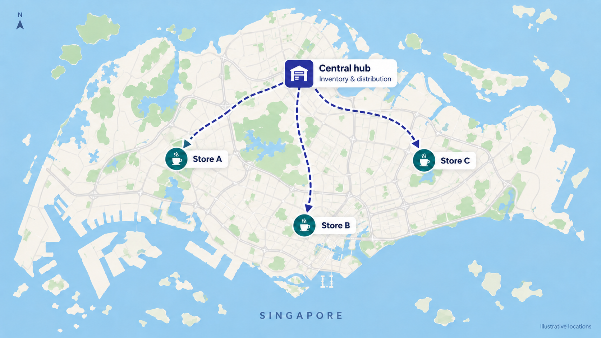

# Coffee Shop Demand Forecasting

[View the interactive analysis](https://alexwang-01.github.io/coffee-shop-demand-forecasting/) ·
[Methodology](docs/methodology.md) · [Validation notes](docs/validation.md)

This project turns six months of coffee-shop transactions into weekly and monthly stock-item demand
forecasts. It compares 16 classical statistical and machine-learning candidates, selects one method
for each demand group using May, and evaluates those frozen choices retrospectively on June.

The source data describe three fictitious New York City stores. For the project scenario, their IDs
are relabelled Store A, Store B and Store C and their derived stock requirements are pooled at one
hypothetical Singapore hub. The central hub and bill of materials are explicit project assumptions.



## From transactions to forecast requirements

```text
149,116 transaction rows
          │
          ▼
80 products × project-defined BOM
          │
          ▼
64 ingredients, packaging and ready-to-sell stock items
          │
          ▼
61 independent demand groups
          │
          ├── May: compare 16 candidates and choose lowest MSE per group
          ├── June: evaluate the frozen choices against seasonal naive
          └── July: refit selected methods and forecast 7 or 31 days
```

Three pairs of stock items have demand that is exactly proportional under the BOM. The workflow fits
those shared signals once and restores each item's quantity with its verified ratio. This avoids
counting duplicate forecasting problems while retaining all 64 stock-item outputs.

## What the project demonstrates

- **Causal backtesting:** each forecast uses only history available at its origin.
- **Per-group selection:** all eligible candidates compete on the same May dates; the lowest MSE wins.
- **Separate weekly and monthly decisions:** a sticky horizon switch updates only the horizon-specific
  content, making the trade-off between 7-day and full-month planning easy to inspect.
- **Readable evidence:** method explanations, an interactive teaching simulator, category comparisons,
  model selections and July quantities are shown without exposing notebook code in the interface.
- **Reproducible outputs:** the source hash, assumptions, result manifests, notebooks and automated
  reconciliation tests are included.

## Verified June results

The common baseline repeats the demand observed seven days earlier. MASE puts litres, kilograms and
individual units on a comparable error scale; lower is better.

| Horizon | Selected models | Seasonal-naive baseline | Reduction in mean MASE | Groups worse than baseline |
|---|---:|---:|---:|---:|
| Weekly | 0.999 | 1.366 | 26.9% | 0 of 61 |
| Monthly | 1.082 | 1.308 | 17.2% | 5 of 61 |

These figures compare average scaled error, not percentages of demand. The monthly horizon is harder:
it predicts up to 31 days recursively and offers only one full May validation origin. The interface
keeps the five weaker monthly groups visible rather than replacing them after seeing June.

## Candidate methods

| Family | Methods |
|---|---|
| Classical | Naive, seasonal naive, MA(7), MA(14), SES, Holt, additive Holt-Winters, multiplicative Holt-Winters, ARIMA, SARIMA |
| Machine learning | Linear regression, Ridge(1), Ridge(10), random forest, Boosting(1), Boosting(10) |

The ML models use lagged demand, trailing means and variation, a time index and weekday sine/cosine
features. ARIMA/SARIMA orders are identified on January-April data and frozen. See
[the methodology](docs/methodology.md) for the full selection and evaluation design.

## Repository layout

```text
├── config/                 Experiment definition and source hash
├── data/
│   ├── raw/                Public-domain source workbook
│   └── assumptions/        Project BOM, material definitions and scenario boundary
├── docs/                   GitHub Pages site, methodology and validation notes
├── notebooks/              Executed EDA, weekly and monthly notebooks
├── results/
│   ├── eda/                Data-review outputs
│   ├── weekly/             Seven-day experiment outputs and manifest
│   └── monthly/            Calendar-month experiment outputs and manifest
├── src/                    Forecasting, notebook and site build code
└── tests/                  Selection, causality and reconciliation safeguards
```

## Reproduce the analysis

Python 3.12 is used by the checked workflow.

```powershell
python -m venv .venv
.\.venv\Scripts\Activate.ps1
python -m pip install -r requirements-dev.txt

python src/weekly_forecasts.py
python src/monthly_forecasts.py
python src/build_eda_notebook.py
python src/build_weekly_notebook.py
python src/build_monthly_notebook.py
python src/build_site_content.py
python src/audit_results.py

$env:PYTHONPATH = "src"
python -m unittest discover -s tests -p "test_*.py"
ruff check src tests
ruff format --check src tests
```

Preview the static site locally:

```powershell
python -m http.server 8000 --directory docs
```

Then open `http://127.0.0.1:8000/`. The published site uses the same static HTML, CSS and JavaScript;
it does not require a Python server after deployment.

## Data source and scope

The unchanged workbook is the [Maven Analytics Coffee Shop Sales dataset](https://mavenanalytics.io/data-playground/coffee-shop-sales),
which Maven describes as transactions for three fictitious NYC stores and licenses as Public Domain.
The repo separates that observed source from the project-defined Singapore scenario and BOM in
[data/README.md](data/README.md).

July actuals are unavailable, so July values are forecasts rather than evaluated results. This release
stops at demand forecasting: opening inventory, replenishment policy, supplier constraints, cost and
distribution optimisation remain outside scope.

Project code and documentation are released under the [MIT License](LICENSE). The source workbook
retains its Public Domain status and attribution.
